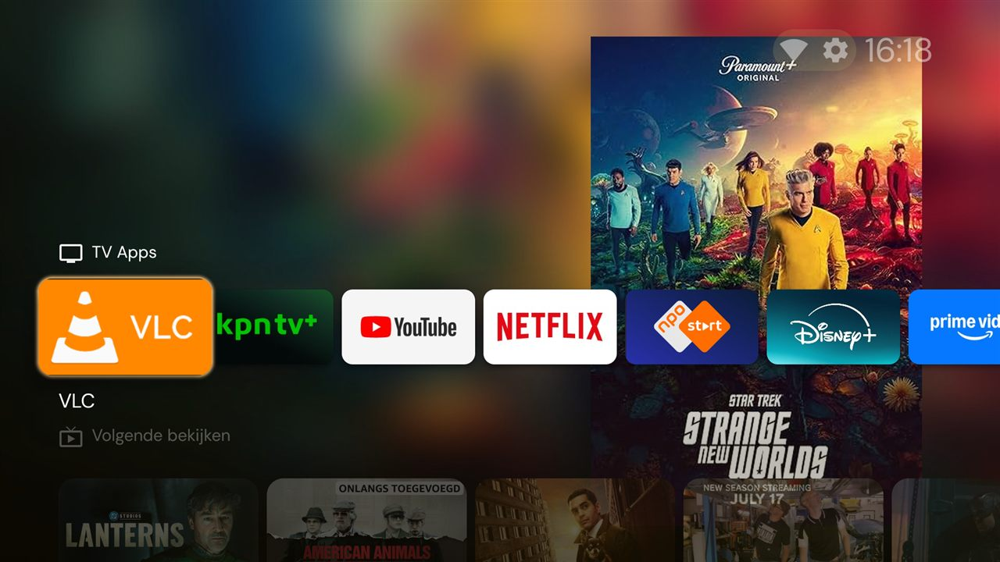
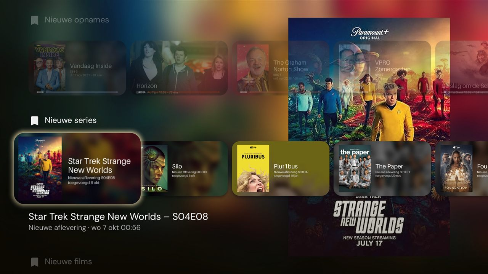

# custom-android-tv

Een eigen, rustig startscherm voor Android/Google TV, op boxen én op televisies met Android TV ingebouwd, zonder te rooten of de Google-launcher te verwijderen. Per apparaat een eigen map onder `devices/`, zodat latere units er los naast kunnen.

| Apparaat | Map | Stand |
|---|---|---|
| Thomson 240G (Google TV, Android 14) | [`devices/thomson-240g`](devices/thomson-240g) | In gebruik |

## Wat het oplevert (Thomson 240G)



Projectivy Launcher is het startscherm, met een eigen app en een kleine server erachter. Je ziet je streamingdiensten, en daaronder rijen uit je eigen opnames en videobibliotheek: *Verder kijken*, *Nieuwe opnames*, *Nieuwe series* en *Nieuwe films*. Hieronder een voorbeeld:

| |
|---|
|  |
| **Nieuwe opnames** (uit NextPVR, met voortgangsbalk) en **Nieuwe series** (met posters) |

De achtergrond is de poster van het eerste item uit *Nieuwe opnames*, *Nieuwe series* en *Nieuwe films*, om de beurt (een Projectivy-wallpaperplug-in). Een kaart aanklikken start de film of opname in VLC, en hervat bij "Verder kijken" op de plek waar je gebleven was.

## Hoe het werkt

```
NextPVR / videoschijven ──► tvfeed (Docker, op de server)  ──►  app "Thuis-rijen" op de box  ──►  Projectivy
   opnames, kijkvoortgang      rijen + 16:9-kaarten + hero         preview-kanalen + wallpaper-provider   toont de rijen
   posters (OMDb/TheTVDB)      + serveert het bestand (Range)       kaart → VLC (http)
```

- [`devices/thomson-240g/tvfeed`](devices/thomson-240g/tvfeed): Python-container die NextPVR leest (alleen-lezen), de volgorde bepaalt, kaarten tekent en de bestanden streamt.
- [`devices/thomson-240g/apps/tvrows`](devices/thomson-240g/apps/tvrows): kleine Android-app (geen Gradle, `build.ps1`) die de kanalen publiceert en als Projectivy-wallpaperplug-in dient.
- [`devices/thomson-240g/README.md`](devices/thomson-240g/README.md): wat wel en niet werkt op deze box, met de adb-opdrachten.
- [`devices/thomson-240g/TERUGDRAAIEN.md`](devices/thomson-240g/TERUGDRAAIEN.md): elke wijziging aan het apparaat, met hoe je die terugdraait.

## Afspraken
- Niets onomkeerbaars zonder akkoord (geen debloat, geen systeemapps verwijderen). Elke ingreep staat met terugdraaiopdracht in het logboek van het apparaat.
- Geen wachtwoorden, sleutels of PIN's in deze repo; die staan in een `secrets.json` (chmod 600) op de server.
